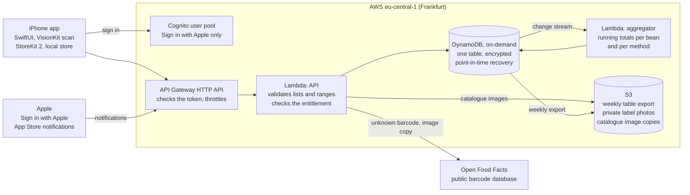

# System design on AWS

The backend is six managed, pay-per-use services in one region (eu-central-1, Frankfurt). There are no servers, no VPC and no relational database, so an idle system costs close to nothing.

Every request passes the token check and server-side validation before it reaches the table. The aggregator keeps the paid tier's totals current, and the table exports itself to S3 weekly.

## Components

| Component | Choice | Why it is the cheap and safe option |
| --- | --- | --- |
| Client | Native iOS: SwiftUI, SwiftData local store, VisionKit scanner, StoreKit 2 | Scanning and offline storage run on the device at no cloud cost |
| Identity | Cognito user pool, Lite tier, Sign in with Apple as the only provider | First 10,000 monthly active users are free; no passwords or emails to store |
| API | API Gateway HTTP API with its built-in JWT authorizer | Cheaper than REST API; token check needs no extra Lambda |
| Compute | Lambda on arm64, one API function plus three small workers | Billed per request; large permanent free allowance |
| Data | DynamoDB, one table, on-demand capacity | No minimum fee; multi-AZ by default; encrypted at rest |
| Files | S3, two private buckets: label photos and catalogue image copies, backups | Cents per GB; lifecycle rules delete or archive automatically |
| Jobs | EventBridge Scheduler | Nightly rankings and weekly export, effectively free |
| Secrets | Systems Manager Parameter Store (SecureString) | Free standard tier, unlike Secrets Manager |
| Deploy | AWS CDK from GitHub Actions via OIDC | No long-lived access keys anywhere |

Deliberately left out at launch: WAF, NAT gateway, RDS or Aurora, OpenSearch, ElastiCache, a customer-managed KMS key. Each adds a fixed monthly fee.

## Data model

One DynamoDB table holds everything. The partition key decides who can reach an item.

| Item | Partition key | Sort key | Holds |
| --- | --- | --- | --- |
| User profile | `USER#<id>` | `PROFILE` | Consent (`contribute_to_aggregates`, opt-in, D1) and locale, as the contract's `Profile` in `values`; entitlement and expiry from M4. Written only by `PUT /profile`, as an update that keeps other attributes; absent until then (`GET /profile` is 404) |
| Shelf entry | `USER#<id>` | `SHELF#<shelfEntryId>` | Bean, purchase date, roast date, bag size, price band; count of the brews that reference it (ADR 0012) |
| Brew with rating | `USER#<id>` | `BREW#<brewedAt UTC>#<brewId>` | Method, parameters, 8 scores, intensities, notes, buy again, schema version; its shelf entry and that entry's bean (ADR 0012) |
| Brew pointer | `USER#<id>` | `BREWID#<brewId>` | The brew's current sort key, for reads by id |
| Recipe | `USER#<id>` | `RECIPE#<id>` | Saved parameter set |
| Bean | `BEAN#<beanId>` | `META` | Picked attributes (process, roast level; origin, species and variety from vocabulary v2), operator attributes including the curated roaster, Open Food Facts name, brand and the id of the stored image copy, each group tagged with its source; status |
| Barcode | `BARCODE#<ean>` | `BEAN` | Pointer to the bean |
| Open Food Facts cache | `BARCODE#<ean>` | `OFF` | The fetched product (name, brand, the id of the stored image copy) or a miss, fetch time; TTL on a miss |
| Lookup counter | `USER#<id>` | `LOOKUPS#<YYYY-MM-DD>` | The caller's Open Food Facts lookups that UTC day; TTL |
| Pending label photo | `USER#<id>` | `PHOTO_PENDING#<photoId>` | An upload the caller started and has not completed: the bean id; TTL 1 day (ADR 0016) |
| Label photo, user side | `USER#<id>` | `PHOTO#<photoId>` | The caller's completed label photo: bean id, creation time. The only link from a photo to its uploader (D10) |
| Label photo count | `USER#<id>` | `BEANPHOTOS#<beanId>` | How many label photos the caller completed for the bean; at most 3 |
| Label photo upload counter | `USER#<id>` | `PHOTO_UPLOADS#<YYYY-MM-DD>` | The caller's new label photo uploads that UTC day; TTL |
| Account tombstone | `DELETED#<id>` | `META` | Written first by `DELETE /account` (ADR 0017, Addendum): when the deletion began, the ids of the label photos deleted in full, whether the deletion log entry is written; TTL 2 hours after the last call. While it is in force, every write of that user is refused (401) |
| Aggregate, all methods | `BEAN#<beanId>` | `AGG#ALL` | Rater count; count, sum and sum of squares per criterion; note counts |
| Aggregate per method | `BEAN#<beanId>` | `AGG#METHOD#<method>` | Same, plus recipe histogram buckets |
| Rater marker | `BEAN#<beanId>` | `RATER#<id>` | Proves a distinct rater; drives give-to-get |
| Label photo, bean side | `BEAN#<beanId>` | `PHOTO#<photoId>` | A stripped label photo of the bean for the operator's review: creation time, no user id (ADR 0016) |
| Ranking | `RANK#<facet>` | `<period>` | Precomputed top list; facet and period formats in ADR 0010 |

Ids in keys are server-generated ULIDs; `brewedAt` is fixed-width UTC (`toISOString()`), so brews list newest first. A brew, its pointer and the brew count of its shelf entry are always written in one transaction (ADR 0010, ADR 0012), so a shelf entry with brews cannot be deleted. `backend/src/repository/` builds every key and is the only code that talks to the table.

The table's TTL attribute is `expires_at` (a number, epoch seconds). Only the items marked "TTL" above carry it: an Open Food Facts miss, the daily lookup and label photo upload counters, a pending label photo and an account tombstone. DynamoDB deletes such an item some time after that moment (usually within a few days), at no charge, so reads must still compare `expires_at` with the current time. TTL deletes appear in the stream like any other delete; the aggregator must ignore them (they are not brews). It also ignores tombstones (`ACCOUNT_TOMBSTONE`). The brew deletes of an account deletion are ordinary brew removes, which it subtracts (D2).

One sparse index (`gsi1`) lists unverified beans for the review queue: only an unverified bean's `META` item carries `gsi1pk=REVIEW#UNVERIFIED` and `gsi1sk=<createdAt UTC>#<beanId>`, and verifying or rejecting the bean removes both (infra/README.md). Rejecting a bean also deletes its `BARCODE#` pointer in the same transaction, so the barcode can be submitted again; the rejected `META` item stays for the operator and is never returned by the API (owner decision, 2026-11-25; M1-T4a). A rejected bean cannot be newly put on a shelf (404); shelf entries that already name it keep working, including a replace that keeps the same bean (M1-T11). The user id always comes from the verified token, never from the request body, so a user can only ever address their own `USER#` partition.

## Aggregation pipeline

1. A brew is written to the user's partition.
2. DynamoDB Streams hands the change to the aggregator Lambda in batches.
3. The aggregator adds the scores to the running totals of the bean and of the bean-and-method item, using atomic counters. Edits and deletes apply the difference. It acts on brew items only and ignores every other item type in the stream (shelf entries, pointers, label photo items, counters and TTL deletes).
4. Reading a bean page is then one or two item reads, with mean and spread computed from count, sum and sum of squares.
5. A nightly job reads the aggregate items (one per bean) and writes the ranking lists.

This keeps the paid tier's read cost flat no matter how many brews exist. If ad hoc analysis is needed later, the weekly S3 export can be queried with Athena, paying per query.

## Barcode lookup

The phone sends only the barcode and, later, the user's confirmation. The backend talks to Open Food Facts, so no text ever travels from a client to the API (ADR 0005, invariant 1).

- Known barcodes are answered from the `BARCODE#` items (`GET /barcodes/{barcode}`).
- Unknown barcodes: the app calls `GET /barcodes/{barcode}/open_food_facts`, and the backend looks the barcode up in [Open Food Facts](https://openfoodfacts.github.io/openfoodfacts-server/api).
  - **User-Agent.** Every request names the app and a contact address, in the form Open Food Facts asks for (`Cupmark/<version> (<contact>)`). The contact is an operator mailbox set in configuration (the API Lambda's environment variable `OFF_CONTACT`, never Secrets Manager), not in the repository: the deploy workflow passes it from the GitHub environment secret `OFF_CONTACT` (a secret only so that GitHub masks it in the public log) as CDK context, and a deploy without it fails at synth (ADR 0019). Without a valid contact the route makes no outbound call and answers 503 for anything not already cached. Requests go over HTTPS to the read API and, for the image copy, the image host only; the Lambda needs outbound HTTPS to those two Open Food Facts hosts and nothing else outside AWS.
  - **Outbound request (M1-T4b).** `GET https://world.openfoodfacts.org/api/v2/product/<EAN-13>.json?fields=product_name,brands,image_front_url` (`image_front_url` since M1-T4c), built in code from a fixed origin and the canonical barcode; Node's built-in fetch, no dependency. Redirects are never followed (a 3xx, or a response that names another URL, is 503). One deadline of 3 s covers the whole exchange, and the body is read up to 64 KiB. `status: 0` is a miss; `status: 1` with a product is a hit if it has a name or a brand after cleaning or a front image that is copied (Image copy, below), else a miss; anything else (a 404 without that body, 429, 5xx, a wrong content type, bad JSON or UTF-8) is 503. The v2 shape used is the known one; the official docs could not be fetched from the build environment, so it should be checked against them once.
  - **Catalogue cache.** The result, a hit or a miss, is stored in the catalogue under the barcode (`BARCODE#<ean>` / `OFF`), so each barcode is fetched from Open Food Facts once across all users. A miss carries `expires_at` 30 days after the fetch and is retried after that, because products get added; reads compare `expires_at` with the clock, since the TTL delete comes later. A hit has no `expires_at` and is never overwritten (the write is conditional on no item or a miss; if two fetches race, both answer with the hit stored first). A failed or timed-out fetch caches nothing and answers 503. Open Food Facts rate limits then apply to our one server, so the cache is what keeps us inside them.
  - **Per-user daily cap.** Each fetch from Open Food Facts counts against the caller's lookups for the UTC day: a counter `USER#<id>` / `LOOKUPS#<YYYY-MM-DD>`, raised by one atomic `ADD` on the condition that it is below the cap, so parallel calls cannot overshoot and a counted fetch costs one write. The item's `expires_at` is the start of its day plus 2 days. Over the cap the route answers 429 until the next UTC day. The cap protects Open Food Facts and stops anyone using us to scrape it. The number is configuration (`OFF_LOOKUP_CAP`, default 50 a day, 0 to 10,000; 0 stops all fetches, an invalid value fails closed with 503).
  - **What counts (decided by the lead under ADR 0014, M1-T4b).** The route checks, in order: a malformed barcode or bad check digit (400), a barcode already in the catalogue (409), the cache (a hit is 200, an unexpired miss 404), the configuration (503), then the cap (429), then fetches. Only the last step writes the counter, so 400, 409, cache answers and configuration failures do not count; a fetch counts whether it finds a product, finds none or fails with 503 (Open Food Facts did the work or was under load, and a retry loop must not be free). Why cache reads are not counted, and why that is safe:
    - They never reach Open Food Facts, which is what the cap protects.
    - They only return what some user's counted fetch already stored, so scraping through them is bounded by the caps that filled the cache, and the data is Open Food Facts' public data anyway.
    - A cache read costs one Lambda call and two item reads, the same as `GET /barcodes/{barcode}`, which has no per-user count either. Counting it would add a write (more expensive than the reads it guards) to every call. Floods of cheap reads are bounded like every other route: API Gateway stage throttling, the Lambda concurrency cap and the budget alarm (Security).
    - Over the cap, cached barcodes still answer, so a user who hit the cap can still confirm what they scanned.
  - A hit returns name, brand and the front image. Text is untrusted: trimmed, cut to the contract's maximum length in code points, stored and returned as plain data, never interpreted as markup and never logged. Cleaning (`backend/src/openfoodfacts/text.ts`): NFC; line breaks and other white-space controls become a space; other control characters, lone surrogates, the byte-order mark and bidirectional override and isolate controls are removed; runs of white space collapse; the cut keeps whole graphemes where it can (no split emoji); empty after cleaning is absent. The brand is the first non-empty entry of the comma-separated `brands` field.
  - **Image copy (ADR 0011).** When a hit is cached, the backend downloads its front image once from the Open Food Facts image host (only a URL on that host for the same 13-digit barcode is followed), strips all metadata (EXIF, XMP, GPS; D12), checks that the result is a JPEG within a size limit, and stores it in the photo bucket as `catalogue/<imageId>.jpg`, where `imageId` is a new ULID. The cache item and, after confirmation, the bean hold only that `imageId`; the API returns it as `image_id`, and `GET /catalogue_images/{image_id}` returns the stored bytes behind the token. The app never contacts Open Food Facts, so no user's IP address reaches it. If the image cannot be fetched or is not a valid JPEG, the hit is cached without an image. Catalogue images are shared catalogue data, not tied to a user: they follow the photo bucket's lifecycle rules (nothing under `catalogue/` expires) and account deletion does not remove them (D10). Choices (M1-T4c, `backend/README.md` has the detail):
    - The URL is the product's `image_front_url` (the 400-pixel display image), followed only if it is exactly `https://images.openfoodfacts.org/images/products/<3>/<3>/<3>/<4>/front[_<lang>].<rev>.<size>.jpg` for the same EAN-13: no userinfo, port, query or fragment. A missing or unusable URL is no image. A product with a name or brand whose copy fails is a hit without an image. A product whose only content is the image is different (D15; decided by: lead, ADR 0014): a transient copy failure (timeout, network, HTTP 429 or 5xx, S3, no bucket configured) is 503 and caches nothing, so a later lookup tries again; a permanent one (redirect, another 4xx, wrong content type, too large, not a valid JPEG) is cached as a miss. The fetch counts against the cap either way, since Open Food Facts did the work.
    - The download has its own 2.5 s deadline, no redirects, `Content-Type: image/jpeg` only, and a 1 MiB limit counted on the decoded bytes; the S3 write has 2 s. With the 3 s read API, that stays inside the 10 s Lambda timeout.
    - Stripping is a pure TypeScript rewrite of the JPEG marker stream, no dependency: APP1 to APP15 (EXIF, XMP, ICC, IPTC) and COM are dropped, as is anything after EOI; the original APP0 and APP14 are replaced by canonical ones (no JFIF thumbnail; only the Adobe colour transform) where the input had them, so colours decode as before. Only baseline, extended and progressive 8-bit Huffman JPEGs up to 4096 pixels a side pass.
    - `GET /catalogue_images/{image_id}` answers with `Content-Type: image/jpeg`, `X-Content-Type-Options: nosniff` and `Cache-Control: private, max-age=31536000, immutable`: an id names one copy forever, and `private` keeps an authenticated response out of shared caches. 1 MiB is about 1.4 MB as base64, far below the 6 MB Lambda response limit. A missing object, or a function without the bucket name (`PHOTO_BUCKET`), is 404.
    - A hit is never overwritten, so two fetches racing on a new barcode may each store a copy and only the first is referenced; the other object is left in the bucket. The same happens if the S3 write succeeds and the cache write then fails. Both are rare and accepted.
- The app shows the hit for confirmation. Confirming is `POST /beans` with the barcode and `open_food_facts_confirmed`; the backend copies name, brand and image id from its cache into the new unverified bean's `open_food_facts` group and sets `open_food_facts_match`. No cached entry, or a cached miss, is 409 (look the barcode up first). Nothing enters the catalogue as a bean before that.
- Open Food Facts data is under the Open Database License, which requires attribution and share-alike. Catalogue fields taken from it are tagged with their source (the `open_food_facts` group of a bean, D5) and kept apart from the ratings. Have this reviewed before launch.

## Subscriptions

- Purchase runs through StoreKit 2. The app sends the signed transaction to the API.
- The API function verifies Apple's signature and writes entitlement and expiry to the user profile.
- App Store Server Notifications (version 2) post renewals, expiries and refunds to a dedicated route. That route is unauthenticated but accepts only payloads with a valid Apple signature.
- Paid endpoints read the entitlement from the profile on each call. No third-party subscription service is needed.

## Security

| Layer | Measure |
| --- | --- |
| Identity | Sign in with Apple; only Apple's opaque user id is stored; no name is requested |
| Tokens | Access tokens valid for 60 minutes; refresh token in the iOS Keychain |
| Authorisation | Partition key derived from the token; paid and give-to-get checks in the API function |
| Input | Every field validated server-side against a closed list or a numeric range. With no text fields there is nothing to inject or moderate |
| Abuse | API Gateway throttling; per-user daily write cap; App Attest on write routes |
| Encryption | TLS in transit; DynamoDB encrypted at rest with the AWS-owned key and S3 with SSE-S3, both at no charge and with no KMS key (owner decision, 2026-11-25). The only KMS use is the AWS-managed `aws/ssm` key behind the cursor-signing SecureString (ADR 0013, owner-approved): no monthly fee, and decryption stays in the free tier |
| Access to AWS | Shared account isolated by ADR 0002 and 0009 (a separate account remains the later option); root with MFA and no keys; least-privilege role per function; CloudTrail on. Deploys only from GitHub Actions through OIDC (ADR 0018): dev after CI passed on `main`, prod by hand with the owner's approval in the `prod` environment (ADR 0019) |
| Privacy | Aggregates only above 5 raters; in-app export and account deletion; no third-party SDKs; data stays in the EU |
| Account deletion | `DELETE /account` runs in the request (ADR 0017): a tombstone first, then every version of the user's label photos of beans that are not verified (and the raw uploads of all their photos) with the beans' records of them, then every item of `USER#<id>`, then an ids-only entry in the deletion log bucket, then the Cognito user. 204 only when all succeeded; any failure is 500 and a retry repeats every step safely. The tombstone makes every write with a token issued before the deletion fail (401) for 2 hours, longer than any token lives. Details: `backend/README.md`, Account deletion |
| Export | `GET /export` returns every item of the caller as CSV with the columns fixed in the contract, up to 5 MiB (about 13,000 brews) inside the 6 MB Lambda response limit; larger is 500 until an asynchronous export exists |
| Cost attack | AWS Budgets alarm at 10 USD; Lambda concurrency cap; throttling limits the worst case |

## Persistence and recovery

- DynamoDB stores every write in three availability zones.
- Point-in-time recovery is on: restore to any second in the last 35 days.
- Deletion protection is on for the table; both buckets block public access and keep versions.
- **Label photos (ADR 0016).** The photo bucket holds them next to the catalogue image copies. `POST /beans/{bean_id}/label_photos` returns a presigned S3 POST for `uploads/<photoId>.jpg` (exact key, `image/jpeg`, 1 byte to 8 MiB, 10 minutes); the app uploads straight to S3. `POST /label_photos/{photo_id}/complete` reads the upload, strips all metadata with the same JPEG rewriter as the catalogue images (D12), writes `labels/<photoId>.jpg`, and only then records the photo in one transaction: the uploader's `PHOTO#` item, the bean's `PHOTO#` item without a user id, and the per-user, per-bean count (at most 3 photos per bean, only for an unverified bean). Keys carry only the photo id. The raw uploads expire after 1 day by a lifecycle rule; the only deletes the API makes in S3 are those of account deletion (Security). Each user may start 20 uploads a UTC day. Label photos are never served by the API. `backend/README.md` has the detail and the notes for account deletion (M1-T6).
- A weekly full export goes to the backup bucket, moves to archive storage after 30 days and is kept for a year. Optional: replicate that bucket to Ireland.
- Each phone keeps a full copy of its owner's data, which doubles as a last-resort restore source for that user.
- **Client sync (ADR 0025).** Every local write saves its outbox operation together with the item, in the account's own store, so a write that returned survives the app being ended. One engine per account sends the operations in order, one at a time, building each body when it is sent, so a reference to a new bean or shelf entry carries the server id it got just before. Transport failures, 429 and 5xx back off exponentially with jitter. A 401 after one refresh asks the user to sign in and keeps the queue; this includes the tombstone 401 after account deletion (ADR 0017). A 400 parks the operation and flags the item. 404 on a delete is done. A 404 on a replace is followed by a read of the item: if that is 404 the local item is removed, if the item is there a reference was refused and the operation is parked. A 409 restores a shelf entry or reverts its bean change (D14). A create that got no answer is checked against the user's list, by the body it sent, before it is retried, so no duplicate is made; the check backs off like a send. Two devices: the last write to reach the server wins. Sign-out stops the engine. The sync issues screen (M2-T18) lists parked and flagged items: redo puts a parked operation back at its place (with a parked create of the bean or shelf entry it references); discard removes an item the server never had, or drops a refused change or delete so the next pull restores the server's values; a flag alone is cleared. A barcode scanned offline is a pending bean (M2-T25), saved with the shelf entry it goes on, so it gets brews at once and lives only as long as it has an entry. Online, the outbox looks it up (catalogue, then Open Food Facts) and uses a known bean without asking. A hit is offered for confirmation the next time the app is opened; a miss, or a rejected hit, is offered for a description with pick lists and a label photo as online (docs/04 F1 step 4), or Skip, which creates the bean from its barcode alone. Only the writes that need that bean wait, and they go after it whatever their order. A bean described offline is created without asking and never gets the Open Food Facts name or image later. Label photos taken offline wait in the account's store and upload once their bean has a server id (ADR 0025, Addendum M2-T25). A profile made on the device before the server confirmed it has none (onboarding offline, M2-T29) is checked with `GET /profile` before its `PUT`; if the server has one, the two are merged (the server's locale; consent only if both say yes) and a `PUT` is sent only if that differs from the server's (ADR 0025, Addendum M2-T29).
- **Pull (M2-T17).** On sign-in, on return to the foreground, and after a drain that finished an operation, the engine pulls once the outbox is empty, in its own slot, so a pull never overlaps a drain and local writes go first. It reads every page of `/shelf`, `/brews` and `/recipes`, then `/profile` (404: no profile yet, none is made), then `/beans/{bean_id}` for each shelf bean that is not cached or not verified. Only when every request has answered does it merge, in one save: a server item with no local item is inserted; a synced local item the server no longer lists is removed (not while that list had an item that did not decode, and not a shelf entry that still has brews on the device); an item with a pending or parked operation keeps its local values; any other takes the server's values. Items that do not decode, or whose bean or shelf entry cannot be had, are skipped and counted.
- Target: lose at most seconds of data; restore within a few hours.

## When to revisit

- **Past 10,000 monthly active users:** Cognito starts charging per user. With an iOS-only app the alternative is to verify Apple's identity token in a small Lambda authorizer and issue your own session token, which is free at any scale but is security code you then own.
- **Android or web client:** add Google sign-in to the same user pool; the API does not change.
- **Abuse in practice:** add WAF with a rate rule, accepting its fixed monthly fee.
