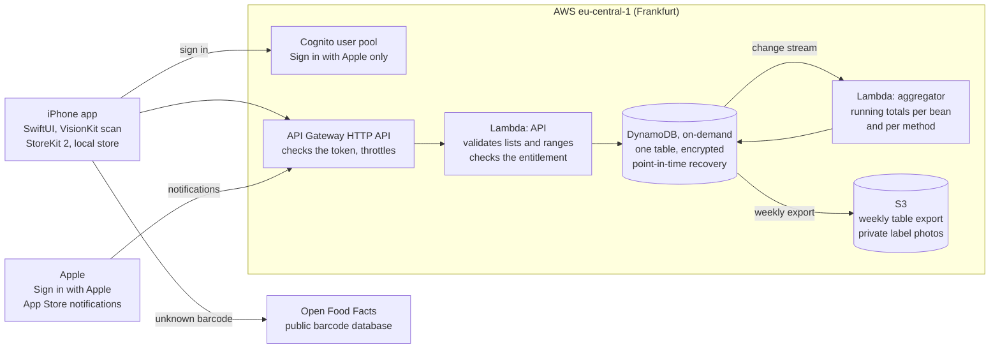

# System design on AWS

The backend is six managed, pay-per-use services in one region (eu-central-1, Frankfurt). There are no servers, no VPC and no relational database, so an idle system costs close to nothing.

Every request passes the token check and server-side validation before it reaches the table. The aggregator keeps the paid tier's totals current, and the table exports itself to S3 weekly.

## Components

| Component | Choice | Why it is the cheap and safe option |
| --- | --- | --- |
| Client | Native iOS: SwiftUI, SwiftData local store, VisionKit scanner, StoreKit 2 | Scanning and offline storage run on the device at no cloud cost |
| Identity | Cognito user pool, Lite tier, Sign in with Apple as the only provider | First 10,000 monthly active users are free; no passwords or emails to store |
| API | API Gateway HTTP API with its built-in JWT authorizer | Cheaper than REST API; token check needs no extra Lambda |
| Compute | Lambda on arm64, one API function plus three small workers | Billed per request; large permanent free allowance |
| Data | DynamoDB, one table, on-demand capacity | No minimum fee; multi-AZ by default; encrypted at rest |
| Files | S3, two private buckets: label photos, backups | Cents per GB; lifecycle rules delete or archive automatically |
| Jobs | EventBridge Scheduler | Nightly rankings and weekly export, effectively free |
| Secrets | Systems Manager Parameter Store (SecureString) | Free standard tier, unlike Secrets Manager |
| Deploy | AWS CDK from GitHub Actions via OIDC | No long-lived access keys anywhere |

Deliberately left out at launch: WAF, NAT gateway, RDS or Aurora, OpenSearch, ElastiCache, a customer-managed KMS key. Each adds a fixed monthly fee.

## Data model

One DynamoDB table holds everything. The partition key decides who can reach an item.

| Item | Partition key | Sort key | Holds |
| --- | --- | --- | --- |
| User profile | `USER#<id>` | `PROFILE` | Entitlement and expiry, consent flags, locale |
| Shelf entry | `USER#<id>` | `SHELF#<shelfEntryId>` | Bean, purchase date, roast date, bag size, price band |
| Brew with rating | `USER#<id>` | `BREW#<brewedAt UTC>#<brewId>` | Method, parameters, 8 scores, intensities, notes, buy again, schema version |
| Brew pointer | `USER#<id>` | `BREWID#<brewId>` | The brew's current sort key, for reads by id |
| Recipe | `USER#<id>` | `RECIPE#<id>` | Saved parameter set |
| Bean | `BEAN#<beanId>` | `META` | Roaster, origin, process, variety, roast level, status, source |
| Barcode | `BARCODE#<ean>` | `BEAN` | Pointer to the bean |
| Aggregate, all methods | `BEAN#<beanId>` | `AGG#ALL` | Rater count; count, sum and sum of squares per criterion; note counts |
| Aggregate per method | `BEAN#<beanId>` | `AGG#METHOD#<method>` | Same, plus recipe histogram buckets |
| Rater marker | `BEAN#<beanId>` | `RATER#<id>` | Proves a distinct rater; drives give-to-get |
| Ranking | `RANK#<facet>` | `<period>` | Precomputed top list; facet and period formats in ADR 0010 |

Ids in keys are server-generated ULIDs; `brewedAt` is fixed-width UTC (`toISOString()`), so brews list newest first. A brew and its pointer are always written in one transaction (ADR 0010). `backend/src/repository/` builds every key and is the only code that talks to the table.

One sparse index (`gsi1`) lists unverified beans for the review queue: only an unverified bean's `META` item carries `gsi1pk=REVIEW#UNVERIFIED` and `gsi1sk=<createdAt UTC>#<beanId>`, and verifying or rejecting the bean removes both (infra/README.md). The user id always comes from the verified token, never from the request body, so a user can only ever address their own `USER#` partition.

## Aggregation pipeline

1. A brew is written to the user's partition.
2. DynamoDB Streams hands the change to the aggregator Lambda in batches.
3. The aggregator adds the scores to the running totals of the bean and of the bean-and-method item, using atomic counters. Edits and deletes apply the difference.
4. Reading a bean page is then one or two item reads, with mean and spread computed from count, sum and sum of squares.
5. A nightly job reads the aggregate items (one per bean) and writes the ranking lists.

This keeps the paid tier's read cost flat no matter how many brews exist. If ad hoc analysis is needed later, the weekly S3 export can be queried with Athena, paying per query.

## Barcode lookup

- Known barcodes are answered from the `BARCODE#` items.
- Unknown barcodes are looked up in [Open Food Facts](https://openfoodfacts.github.io/openfoodfacts-server/api) directly from the phone. Its documentation says limits apply per user when requests come from users' devices, and asks for a custom User-Agent.
- Results are cached in the bean catalogue, so each barcode is fetched once across all users.
- Open Food Facts data is under the Open Database License, which requires attribution and share-alike. Catalogue fields taken from it are tagged with their source and kept apart from the ratings. Have this reviewed before launch.

## Subscriptions

- Purchase runs through StoreKit 2. The app sends the signed transaction to the API.
- The API function verifies Apple's signature and writes entitlement and expiry to the user profile.
- App Store Server Notifications (version 2) post renewals, expiries and refunds to a dedicated route. That route is unauthenticated but accepts only payloads with a valid Apple signature.
- Paid endpoints read the entitlement from the profile on each call. No third-party subscription service is needed.

## Security

| Layer | Measure |
| --- | --- |
| Identity | Sign in with Apple; only Apple's opaque user id is stored; no name is requested |
| Tokens | Access tokens valid for 60 minutes; refresh token in the iOS Keychain |
| Authorisation | Partition key derived from the token; paid and give-to-get checks in the API function |
| Input | Every field validated server-side against a closed list or a numeric range. With no text fields there is nothing to inject or moderate |
| Abuse | API Gateway throttling; per-user daily write cap; App Attest on write routes |
| Encryption | TLS in transit; DynamoDB encrypted at rest with the AWS-owned key and S3 with SSE-S3, both at no charge and with no KMS key (owner decision, 2026-11-25) |
| Access to AWS | Shared account isolated by ADR 0002 and 0009 (a separate account remains the later option); root with MFA and no keys; least-privilege role per function; CloudTrail on |
| Privacy | Aggregates only above 5 raters; in-app export and account deletion; no third-party SDKs; data stays in the EU |
| Cost attack | AWS Budgets alarm at 10 USD; Lambda concurrency cap; throttling limits the worst case |

## Persistence and recovery

- DynamoDB stores every write in three availability zones.
- Point-in-time recovery is on: restore to any second in the last 35 days.
- Deletion protection is on for the table; both buckets block public access and keep versions.
- A weekly full export goes to the backup bucket, moves to archive storage after 30 days and is kept for a year. Optional: replicate that bucket to Ireland.
- Each phone keeps a full copy of its owner's data, which doubles as a last-resort restore source for that user.
- Target: lose at most seconds of data; restore within a few hours.

## When to revisit

- **Past 10,000 monthly active users:** Cognito starts charging per user. With an iOS-only app the alternative is to verify Apple's identity token in a small Lambda authorizer and issue your own session token, which is free at any scale but is security code you then own.
- **Android or web client:** add Google sign-in to the same user pool; the API does not change.
- **Abuse in practice:** add WAF with a rate rule, accepting its fixed monthly fee.
