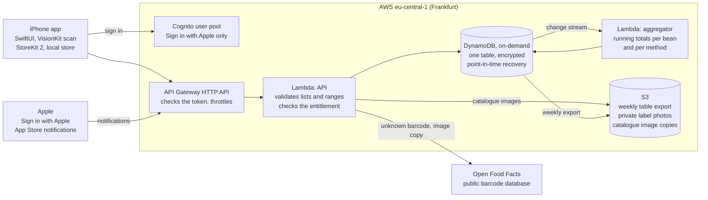

# System design on AWS

The backend is six managed, pay-per-use services in one region (eu-central-1, Frankfurt). There are no servers, no VPC and no relational database, so an idle system costs close to nothing.

Every request passes the token check and server-side validation before it reaches the table. The aggregator keeps the paid tier's totals current, and the table exports itself to S3 weekly.

## Components

| Component | Choice | Why it is the cheap and safe option |
| --- | --- | --- |
| Client | Native iOS: SwiftUI, SwiftData local store, VisionKit scanner, StoreKit 2 | Scanning and offline storage run on the device at no cloud cost |
| Identity | Cognito user pool, Lite tier, Sign in with Apple as the only provider | First 10,000 monthly active users are free; no passwords or emails to store |
| API | API Gateway HTTP API with its built-in JWT authorizer | Cheaper than REST API; token check needs no extra Lambda |
| Compute | Lambda on arm64, one API function plus three small workers | Billed per request; large permanent free allowance |
| Data | DynamoDB, one table, on-demand capacity | No minimum fee; multi-AZ by default; encrypted at rest |
| Files | S3, two private buckets: label photos and catalogue image copies, backups | Cents per GB; lifecycle rules delete or archive automatically |
| Jobs | EventBridge Scheduler | Nightly rankings and weekly export, effectively free |
| Secrets | Systems Manager Parameter Store (SecureString) | Free standard tier, unlike Secrets Manager |
| Deploy | AWS CDK from GitHub Actions via OIDC | No long-lived access keys anywhere |

Deliberately left out at launch: WAF, NAT gateway, RDS or Aurora, OpenSearch, ElastiCache, a customer-managed KMS key. Each adds a fixed monthly fee.

## Data model

One DynamoDB table holds everything. The partition key decides who can reach an item.

| Item | Partition key | Sort key | Holds |
| --- | --- | --- | --- |
| User profile | `USER#<id>` | `PROFILE` | Entitlement and expiry, consent flags, locale |
| Shelf entry | `USER#<id>` | `SHELF#<shelfEntryId>` | Bean, purchase date, roast date, bag size, price band; count of the brews that reference it (ADR 0012) |
| Brew with rating | `USER#<id>` | `BREW#<brewedAt UTC>#<brewId>` | Method, parameters, 8 scores, intensities, notes, buy again, schema version; its shelf entry and that entry's bean (ADR 0012) |
| Brew pointer | `USER#<id>` | `BREWID#<brewId>` | The brew's current sort key, for reads by id |
| Recipe | `USER#<id>` | `RECIPE#<id>` | Saved parameter set |
| Bean | `BEAN#<beanId>` | `META` | Picked attributes (process, roast level; origin, species and variety from vocabulary v2), operator attributes including the curated roaster, Open Food Facts name, brand and the id of the stored image copy, each group tagged with its source; status |
| Barcode | `BARCODE#<ean>` | `BEAN` | Pointer to the bean |
| Open Food Facts cache | `BARCODE#<ean>` | `OFF` | The fetched product (name, brand, the id of the stored image copy) or a miss, fetch time; TTL on a miss |
| Lookup counter | `USER#<id>` | `LOOKUPS#<YYYY-MM-DD>` | The caller's Open Food Facts lookups that UTC day; TTL |
| Aggregate, all methods | `BEAN#<beanId>` | `AGG#ALL` | Rater count; count, sum and sum of squares per criterion; note counts |
| Aggregate per method | `BEAN#<beanId>` | `AGG#METHOD#<method>` | Same, plus recipe histogram buckets |
| Rater marker | `BEAN#<beanId>` | `RATER#<id>` | Proves a distinct rater; drives give-to-get |
| Ranking | `RANK#<facet>` | `<period>` | Precomputed top list; facet and period formats in ADR 0010 |

Ids in keys are server-generated ULIDs; `brewedAt` is fixed-width UTC (`toISOString()`), so brews list newest first. A brew, its pointer and the brew count of its shelf entry are always written in one transaction (ADR 0010, ADR 0012), so a shelf entry with brews cannot be deleted. `backend/src/repository/` builds every key and is the only code that talks to the table.

The table's TTL attribute is `expires_at` (a number, epoch seconds). Only the two items marked "TTL" above carry it: an Open Food Facts miss and the daily lookup counter. DynamoDB deletes such an item some time after that moment (usually within a few days), at no charge, so reads must still compare `expires_at` with the current time. TTL deletes appear in the stream like any other delete; the aggregator must ignore them (they are not brews).

One sparse index (`gsi1`) lists unverified beans for the review queue: only an unverified bean's `META` item carries `gsi1pk=REVIEW#UNVERIFIED` and `gsi1sk=<createdAt UTC>#<beanId>`, and verifying or rejecting the bean removes both (infra/README.md). Rejecting a bean also deletes its `BARCODE#` pointer in the same transaction, so the barcode can be submitted again; the rejected `META` item stays for the operator and is never returned by the API (owner decision, 2026-11-25; M1-T4a). A rejected bean cannot be newly put on a shelf (404); shelf entries that already name it keep working, including a replace that keeps the same bean (M1-T11). The user id always comes from the verified token, never from the request body, so a user can only ever address their own `USER#` partition.

## Aggregation pipeline

1. A brew is written to the user's partition.
2. DynamoDB Streams hands the change to the aggregator Lambda in batches.
3. The aggregator adds the scores to the running totals of the bean and of the bean-and-method item, using atomic counters. Edits and deletes apply the difference.
4. Reading a bean page is then one or two item reads, with mean and spread computed from count, sum and sum of squares.
5. A nightly job reads the aggregate items (one per bean) and writes the ranking lists.

This keeps the paid tier's read cost flat no matter how many brews exist. If ad hoc analysis is needed later, the weekly S3 export can be queried with Athena, paying per query.

## Barcode lookup

The phone sends only the barcode and, later, the user's confirmation. The backend talks to Open Food Facts, so no text ever travels from a client to the API (ADR 0005, invariant 1).

- Known barcodes are answered from the `BARCODE#` items (`GET /barcodes/{barcode}`).
- Unknown barcodes: the app calls `GET /barcodes/{barcode}/open_food_facts`, and the backend looks the barcode up in [Open Food Facts](https://openfoodfacts.github.io/openfoodfacts-server/api).
  - **User-Agent.** Every request names the app and a contact address, in the form Open Food Facts asks for (`Cupmark/<version> (<contact>)`). The contact is an operator mailbox set in configuration, not in the repository. Requests go over HTTPS to the read API and, for the image copy, the image host only; the Lambda needs outbound HTTPS to those two Open Food Facts hosts and nothing else outside AWS.
  - **Catalogue cache.** The result, a hit or a miss, is stored in the catalogue under the barcode (`BARCODE#<ean>` / `OFF`), so each barcode is fetched from Open Food Facts once across all users. A miss is retried after a while (for example 30 days, via TTL), because products get added. A failed or timed-out fetch caches nothing and answers 503. Open Food Facts rate limits then apply to our one server, so the cache is what keeps us inside them.
  - **Per-user daily cap.** Each call to the route counts against the caller's lookups for the UTC day (a counter in the user's partition with a TTL, so it costs one write). Over the cap the route answers 429 until the next day. The cap protects Open Food Facts and stops anyone using us to scrape it; known barcodes are not counted. The number is configuration (default 50 a day).
  - A hit returns name, brand and the front image. Text is untrusted: trimmed, cut to the contract's maximum length in code points, stored and returned as plain data, never interpreted as markup and never logged.
  - **Image copy (ADR 0011).** When a hit is cached, the backend downloads its front image once from the Open Food Facts image host (only a URL on that host for the same 13-digit barcode is followed), strips all metadata (EXIF, XMP, GPS; D12), checks that the result is a JPEG within a size limit, and stores it in the photo bucket as `catalogue/<imageId>.jpg`, where `imageId` is a new ULID. The cache item and, after confirmation, the bean hold only that `imageId`; the API returns it as `image_id`, and `GET /catalogue_images/{image_id}` returns the stored bytes behind the token. The app never contacts Open Food Facts, so no user's IP address reaches it. If the image cannot be fetched or is not a valid JPEG, the hit is cached without an image. Catalogue images are shared catalogue data, not tied to a user: they follow the photo bucket's lifecycle rules (nothing under `catalogue/` expires) and account deletion does not remove them (D10).
- The app shows the hit for confirmation. Confirming is `POST /beans` with the barcode and `open_food_facts_confirmed`; the backend copies name, brand and image id from its cache into the new unverified bean's `open_food_facts` group. Nothing enters the catalogue as a bean before that.
- Open Food Facts data is under the Open Database License, which requires attribution and share-alike. Catalogue fields taken from it are tagged with their source (the `open_food_facts` group of a bean, D5) and kept apart from the ratings. Have this reviewed before launch.

## Subscriptions

- Purchase runs through StoreKit 2. The app sends the signed transaction to the API.
- The API function verifies Apple's signature and writes entitlement and expiry to the user profile.
- App Store Server Notifications (version 2) post renewals, expiries and refunds to a dedicated route. That route is unauthenticated but accepts only payloads with a valid Apple signature.
- Paid endpoints read the entitlement from the profile on each call. No third-party subscription service is needed.

## Security

| Layer | Measure |
| --- | --- |
| Identity | Sign in with Apple; only Apple's opaque user id is stored; no name is requested |
| Tokens | Access tokens valid for 60 minutes; refresh token in the iOS Keychain |
| Authorisation | Partition key derived from the token; paid and give-to-get checks in the API function |
| Input | Every field validated server-side against a closed list or a numeric range. With no text fields there is nothing to inject or moderate |
| Abuse | API Gateway throttling; per-user daily write cap; App Attest on write routes |
| Encryption | TLS in transit; DynamoDB encrypted at rest with the AWS-owned key and S3 with SSE-S3, both at no charge and with no KMS key (owner decision, 2026-11-25). The only KMS use is the AWS-managed `aws/ssm` key behind the cursor-signing SecureString (ADR 0013, owner-approved): no monthly fee, and decryption stays in the free tier |
| Access to AWS | Shared account isolated by ADR 0002 and 0009 (a separate account remains the later option); root with MFA and no keys; least-privilege role per function; CloudTrail on |
| Privacy | Aggregates only above 5 raters; in-app export and account deletion; no third-party SDKs; data stays in the EU |
| Cost attack | AWS Budgets alarm at 10 USD; Lambda concurrency cap; throttling limits the worst case |

## Persistence and recovery

- DynamoDB stores every write in three availability zones.
- Point-in-time recovery is on: restore to any second in the last 35 days.
- Deletion protection is on for the table; both buckets block public access and keep versions.
- A weekly full export goes to the backup bucket, moves to archive storage after 30 days and is kept for a year. Optional: replicate that bucket to Ireland.
- Each phone keeps a full copy of its owner's data, which doubles as a last-resort restore source for that user.
- Target: lose at most seconds of data; restore within a few hours.

## When to revisit

- **Past 10,000 monthly active users:** Cognito starts charging per user. With an iOS-only app the alternative is to verify Apple's identity token in a small Lambda authorizer and issue your own session token, which is free at any scale but is security code you then own.
- **Android or web client:** add Google sign-in to the same user pool; the API does not change.
- **Abuse in practice:** add WAF with a rate rule, accepting its fixed monthly fee.
